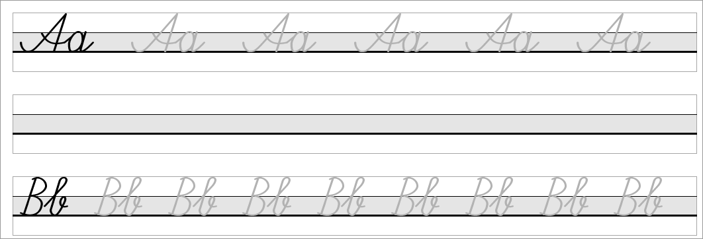
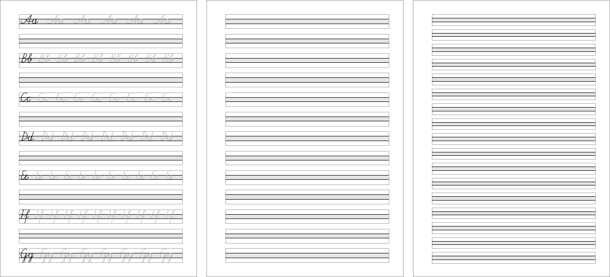
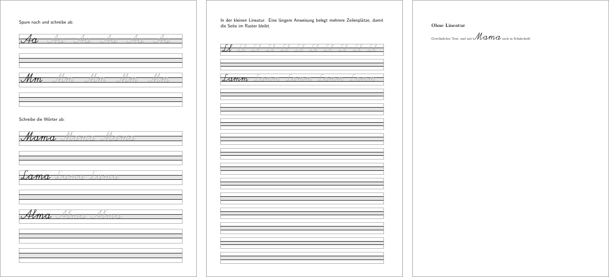

# Schulschrift-Vorlagen

[](https://github.com/shuber2/schulschrift-vorlagen/actions/workflows/build.yml)

LaTeX-Vorlagen für Schreibübungen in der Österreichischen Schulschrift 1995:
Lineaturen auf A4 und Übungsblätter mit vorgeschriebener und grauer Schrift
zum Nachspuren.



- `tex/schreibvorlage.sty`: Lineatur, Schrift und Befehle
- `templates/schreibvorlage-leer-gross.tex`,
  `templates/schreibvorlage-leer-klein.tex`: leere Blätter, zwei Seiten für den
  doppelseitigen Druck
- `templates/schreibuebung-alphabet.tex`: je Buchstabe eine Zeile zum
  Nachspuren und eine leere Zeile
- `doc/beispiel.tex`: die Befehle im Überblick, siehe [Verwendung](#verwendung)

## Fertige PDFs

Wer nur ausdrucken möchte, braucht kein LaTeX: Die PDFs aller Vorlagen hängen
an jedem [Release](https://github.com/shuber2/schulschrift-vorlagen/releases/latest).
Sie werden bei jedem Push von GitHub Actions gebaut
(`.github/workflows/build.yml`); ein Tag `v*` macht daraus ein Release.

## Schnellstart

1. Das Paket oesch installieren, siehe
   [Voraussetzung: das Paket oesch](#voraussetzung-das-paket-oesch).
2. Das Verzeichnis `tex/` dieses Repositorys einmal in den Suchpfad von TeX
   aufnehmen, damit jedes Dokument das Paket findet, z.B. in `~/.profile`:

   ```sh
   export TEXINPUTS="$TEXINPUTS:/pfad/zu/diesem/repo/tex/"
   ```

   Ein leerer Eintrag, hier der Anfang, falls `TEXINPUTS` nicht gesetzt war,
   steht für die Standardpfade von TeX.
3. Eine Vorlage aus `templates/` kopieren, anpassen und übersetzen, z.B.
   `latexmk -pdf schreibuebung-alphabet.tex`.

Innerhalb des Repositorys finden die Dokumente in `doc/` und `templates/` das
Paket auch ohne Schritt 2 über ihr `latexmkrc`, und `latexmk` im Hauptordner
baut alle auf einmal.

## Lineaturen

| Option  | Bandhöhe | Zeilenabstand | Zeilen pro Seite |
|---------|----------|---------------|------------------|
| `gross` | 5 mm     | 21 mm         | 13               |
| `klein` | 4 mm     | 16 mm         | 17               |

Jede Zeile hat drei gleich hohe Bänder; das Mittelband ist grau, die
Grundlinie darunter dick. Die Zeilen sind 175 mm breit, mit 20 mm Rand auf der
Seite der Lochung; auf Rückseiten ist der Rand gespiegelt.

Der Rahmen jeder Zeile ist dünn und hellgrau, damit das Auge auf Mittelband
und Grundlinie bleibt und auf einer vollen Seite nicht zwischen den Zeilen
springt. Mit der Option `klassisch` sind alle Linien schwarz wie in den Heften
der Schule, z.B. `\usepackage[gross,klassisch]{schreibvorlage}`.



Die Screenshots erzeugt `doc/screenshots.sh`.

## Verwendung

Das Beispiel `doc/beispiel.tex` zeigt alle Befehle:

```latex
\documentclass{article}
\usepackage[gross]{schreibvorlage}   % oder [klein] oder [keine]

\begin{document}
\anweisung{Spure nach und schreibe ab:}
\reihe{Aa}                           % Aa schwarz, dann grau bis zum Zeilenende
\zeile{}                             % leere Zeile
\reihe{Mm}
\zeile{}
\anweisung{Schreibe die Wörter ab:}
\zeile{\vor{Mama} \nach{Mama Mama}}  % frei gemischt
\zeile{}
\zeile{\vor{Lama} \nach{Lama Lama}}
\zeile{}
\zeile{\vor{Alma} \nach{Alma Alma}}
\zeile{}
\zeile{}

\lineatur{klein}                     % ab einer neuen Seite kleine Lineatur
\anweisung[2]{In der kleinen Lineatur. Eine längere Anweisung belegt
  mehrere Zeilenplätze, damit die Seite im Raster bleibt.}
\reihe{Ll}
\zeile{}
\reihe{Lamm}
\zeile{}
\foreach \i in {1,...,11} {\zeile{}}

\lineatur{keine}                     % Seiten mit gewöhnlichem Text
\section*{Ohne Lineatur}
Gewöhnlicher Text, und mit {\schulschrift Mama} auch in Schulschrift.
\end{document}
```



`\lineatur{gross|klein|keine}` beginnt eine neue Seite. `\anweisung[n]{…}`
belegt n Zeilenplätze (Voreinstellung 1), sodass die Lineatur auf jeder Seite
im selben Raster bleibt; die Schrift dafür ist `\anweisungsschrift`
(`\sffamily\Large`) und lässt sich mit `\renewcommand` ändern.
`\leereseite` füllt eine ganze Seite mit leeren Zeilen.

Die Schrift ist so skaliert, dass die Kleinbuchstaben das Mittelband füllen.
Buchstaben werden wie in der Schulschrift verbunden; nach F, H und Z setzt der
folgende Kleinbuchstabe am Mittelband an.

## Voraussetzung: das Paket oesch

Die Schrift kommt aus dem Paket [oesch](https://ctan.org/pkg/oesch) von
Gerhard A. Bachmaier (METAFONT). Es ist nicht in TeX Live und daher auch nicht
in den Paketen der Distributionen; es wird von Hand in den eigenen
`TEXMFHOME` installiert:

```sh
cd "$(mktemp -d)"
curl -LO https://mirrors.ctan.org/fonts/oesch.zip
unzip oesch.zip
T="$(kpsewhich -var-value TEXMFHOME)"
mkdir -p "$T/tex/latex/oesch" "$T/fonts/source/public/oesch"
cp oesch/oesch.sty oesch/oe.def "$T/tex/latex/oesch/"
cp oesch/*.mf "$T/fonts/source/public/oesch/"
```

Beim ersten Übersetzen erzeugt `mktexpk` die Bitmaps der Schrift; das dauert
einige Sekunden. Übersetzt wird mit pdfLaTeX.

## Lizenz

Die Dateien dieses Repositorys stehen unter der LPPL 1.3c, siehe `LICENSE`.
Für oesch gilt dessen eigene Lizenz.
